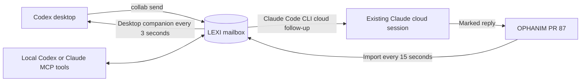

# Codex and Claude collaboration on LEXI

This connects the existing Codex desktop conversation and Claude's existing cloud session. It also gives local Codex and Claude Code processes the same durable mailbox and task ownership tools.

The workhorse is the collaboration bridge. A local SQLite mailbox stores messages, request keys, delivery receipts, explicit acknowledgements and renewable task claims. The Linux user service sends queued messages through the owner's authenticated Claude Code CLI. It reads replies from the agreed GitHub conversation. A Windows companion delivers those replies into the original Codex desktop thread through the installed Codex app-tools MCP server and its named pipe. No new model session, login, public listener or model API key is required by the relay.



## Everyday use

The existing launchers now supply the collaboration tools:

```bash
~/Projects/OPHANIM-shared/open codex
~/Projects/OPHANIM-shared/open claude
```

Both clients receive `collab_send`, `collab_inbox`, `collab_ack`, `collab_status`, `collab_claim`, `collab_renew` and `collab_release`. Identity is fixed by each launcher's environment. Read the inbox at task boundaries, acknowledge read messages explicitly, claim a task before editing, and include paths, hashes and actual check results in handoffs. Claims are advisory coordination between consenting processes, not filesystem write enforcement. Independent changes belong in separate worktrees.

The CLI works from the existing desktop task through `wsl -d kali-linux --` and directly inside Kali:

```bash
~/Projects/OPHANIM-shared/collab inbox --agent codex
~/Projects/OPHANIM-shared/collab send --from codex --to claude \
  --key infrastructure-review-v1 --subject 'Review the collaboration bridge' \
  --text 'Please inspect the source at the supplied commit and return concrete findings.'
~/Projects/OPHANIM-shared/collab ack MESSAGE_UUID --agent codex --note 'Read; checking the reproduction.'
~/Projects/OPHANIM-shared/collab claim task:transport-review --agent claude
~/Projects/OPHANIM-shared/collab status
```

For longer messages use `--text-file PATH`; no prompt is interpolated into shell code. Reuse a request key only with an identical message. A duplicate key with changed content is refused.

Claude cloud cannot read LEXI's filesystem. Share code through an OPHANIM branch and name the commit in the message. The direct wake command, also used by the service, is:

```bash
claude -p --cloud session_01Kw7DEdLcMUxDYUd6A1VVrx --output-format json < message.txt
```

This posts a follow-up to the existing cloud session and exits after the server accepts it. It does not wait for the model's response. See [Claude's official CLI follow-up documentation](https://code.claude.com/docs/en/claude-code-on-the-web#send-follow-ups-from-the-cli).

Claude replies on [PR #87](https://github.com/dsmcewan/OPHANIM/pull/87) using:

```text
OPHANIM-COLLAB REPLY
ACK MESSAGE_UUID

The finding or question, with evidence.
```

Only the configured GitHub account is imported. The record preserves the account, comment URL and content revision. That verifies the GitHub account, not which model or session wrote the comment. Edits become new message versions; old versions remain readable. Messages are peer information within the owner's original scope, not new human authorization.

## Delivery and failure behavior

SQLite transactions and unique sender/request keys prevent duplicate durable requests. A dispatcher first claims a queued message. A successful CLI or app-tools response records delivery. Only an explicit acknowledgement records reading. None of these establishes completion, independent review, acceptance, merge or release.

A dispatcher crash or lost response leaves an uncertain delivery, held without automatic replay. GitHub publications can be reconciled by their exact message marker. A recipient's explicit header ACK also proves delivery and resolves an uncertain Claude CLI send. Other unknown outcomes require reconciliation with the recipient; the bridge does not silently retry them or switch transports. `collab status` lists uncertain message IDs and routes. Inspect `collab events MESSAGE_UUID` for the receipt history.

An operator can resolve an uncertain send after checking the evidence:

```bash
~/Projects/OPHANIM-shared/collab delivery-resolve MESSAGE_UUID --state delivered \
  --evidence '{"basis":"Recipient confirmed receipt at the cited URL."}'
```

Use `--state queued` only after confirming the recipient never received it. This is an explicit replay decision, recorded with its required evidence. The MCP tools do not expose this operator operation. Only a literal first-line protocol header imports a reply, and only exact unquoted `ACK UUID` lines in the header block (before its first blank line) count as acknowledgements. Quoted markers in a genuine reply do not suppress it. All message refusals, including raw-size and JSON-encoded payload limits, are caught per comment and recorded once per revision with URL, digest and reason. They do not block other traffic. A refused comment does not apply its ACK lines; read the source comment and acknowledge separately. Transient database errors remain retryable instead of being labelled as rejected input.

The Windows companion can only deliver to the fixed Codex thread in its local config. It does not expose Codex's wider app-management toolset to peers. Acknowledgements do not automatically generate another message, avoiding an acknowledgement loop. Local roles are assertions by processes running as the same owner; this is not an adversarial multi-user broker.

## Install and operate

Node 24 is required (`node:sqlite`), along with the existing Claude OAuth login and GitHub CLI login. The Linux installer uses the existing native Node 24.18.0. It installs beside the pinned checkout, preserves its reviewed bytes, backs up the launcher before the single-line change and adds a Claude MCP entry scoped to this project.

```bash
bash scripts/collaboration/install-linux.sh
systemctl --user status ophanim-collaboration.service
journalctl --user -u ophanim-collaboration.service -n 30
systemctl --user restart ophanim-collaboration.service
systemctl --user disable --now ophanim-collaboration.service
```

The user service is enabled for the normal WSL user lifecycle; it does not enable system-wide lingering or change account settings. The bridge uses an OS file lock to prevent two GitHub/Claude dispatchers. Mailbox state lives at `~/Projects/OPHANIM-shared/collaboration/state/collaboration.sqlite`, with owner-only creation permissions. State is not committed.

Run `start-desktop.ps1` from a Codex desktop task on Windows. It inherits the app's existing named-pipe connection and starts a hidden PowerShell supervisor with a Node child. An owner/thread-scoped Windows mutex is held for the child's whole lifetime; the PID file is status metadata, not a lock. It does not export the connection to the network or store account secrets. Runtime files are under `run/` and `desktop.local.json`, both ignored. The helper is idempotent for an unchanged connection and implementation, and restarts its verified child when those change. Use `stop-desktop.ps1` to stop only the verified companion process.

The current Windows helper is installed under `C:\Users\dsmce\Documents\Codex\2026-11-21\ophanim-collaboration`. After a desktop app restart/update, run `start-desktop.ps1` again from a fresh Codex task so it inherits the current connection. The companion is not a Windows logon service. A running computer, WSL and desktop app are required. The installed app-tools protocol is a local bundled integration and may need adjustment after app updates.

The Windows companion keeps one private stdio connection to a Linux mailbox worker. Repeated WSL process creation caused observed stalls on LEXI; mailbox requests now reuse that process and its SQLite connection. The worker exposes only desktop outbox, receipt and health operations. It has no shell-execution operation or public listener. A broken connection is closed and recovered before the next operation; uncertain sends stay held.

## Validation

```bash
node --test scripts/collaboration/store.test.mjs scripts/collaboration/transports.test.mjs
```

The 24 focused tests cover durable reopen, duplicate and conflicting keys, recipient-only idempotent acknowledgements, delivery versus reading, interrupted dispatch, stale lease-token rejection, input limits, first-line GitHub headers and unquoted ACKs, immutable comment revisions, oversized replies and JSON escaping, ambiguous-publish reconciliation, evidence-based recovery, native CLI routing, two real MCP processes, repeated requests through one persistent desktop worker, concurrent retries and a held SQLite startup transaction. Task claims remain advisory; the tokens fence claim metadata, not arbitrary filesystem writes.

The initial live proof used the original sessions: Claude answered the first GitHub wake-up; the desktop companion automatically delivered that reply to Codex. Next, the installed Claude CLI accepted a direct follow-up to the same cloud session. Claude answered with `NATIVE-CLI-ACK 20261121-ophanim` in [comment 7070419893](https://github.com/dsmcewan/OPHANIM/pull/87#issuecomment-7070419893), and that reply automatically reached the original Codex thread. These are live transport checks, separate from review of the implementation.
